# NoobPainterSimulation

Pictures painted, drawn, carved and animated **stroke by stroke**, by a simulation, and
turned into videos you can watch being made, in your picture's own shape.

It is not a filter. A real paint simulator mixes paint from named tubes, pushes it
around with bristles, and lets it dry; this project decides, stroke by stroke, where a
painter would put each one, and records the whole thing.

[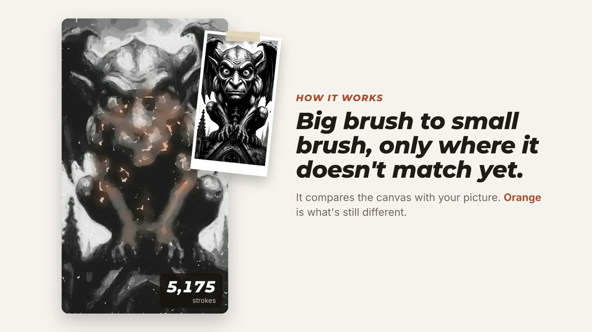](https://github.com/Dankwa-Wadie/NoobPainterSimulation/releases/download/v0.1.0/noobpainter-overview.mp4)

*24-second overview (click to watch). A longer version is on the [Releases page](../../releases).*

| Oil (Van Gogh style) | Pencil and ruler | Pen maze | Compass spiral |
|:---:|:---:|:---:|:---:|
| 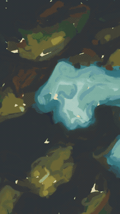 | 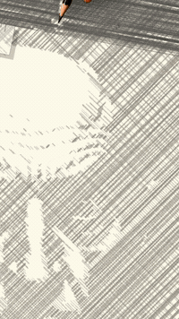 | 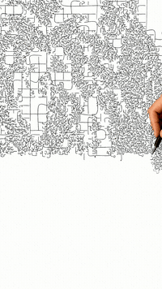 | 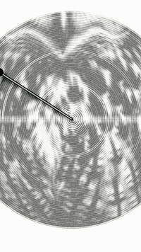 |

| Wood carving | Baroque oil | Moving painting |
|:---:|:---:|:---:|
| 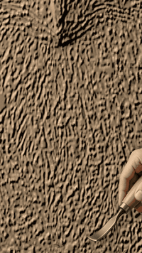 | 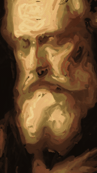 | 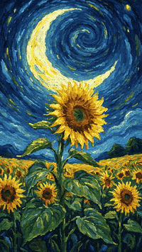 |

Full sample videos (with music) are on the [Releases page](../../releases). These
samples were made with the optional hand overlay on (`--hand`).

## Every style

Each style on a subject that suits it: the oil styles on subjects of their own, the drawing and carving styles on the same owl so they compare directly. Each preview shows the making, then the finished piece in full.

| **Contemporary**<br>`contemporary` | **Impressionist**<br>`impressionist` | **Van Gogh**<br>`van_gogh` | **Old Master**<br>`old_master` | **Baroque**<br>`baroque` |
|:---:|:---:|:---:|:---:|:---:|
|  | 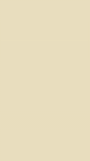 | 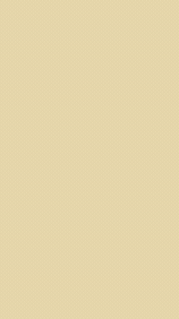 | 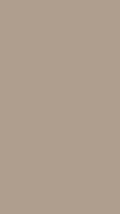 | 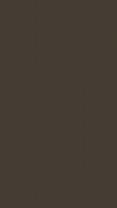 |

| **Pop**<br>`pop` | **Caricature**<br>`caricature` | **B&W exaggerated**<br>`bw_exaggerated` | **Pencil**<br>`pencil` | **Maze**<br>`maze` |
|:---:|:---:|:---:|:---:|:---:|
| 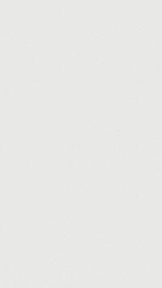 | 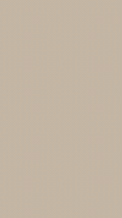 |  | 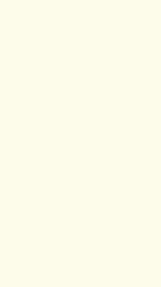 | 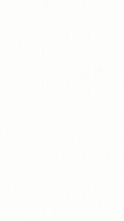 |

| **Waves**<br>`waves` | **Continuous**<br>`continuous` | **Compass spiral**<br>`compass_spiral` | **Relief: wood**<br>`relief_wood` | **Relief: marble**<br>`relief_marble` |
|:---:|:---:|:---:|:---:|:---:|
| 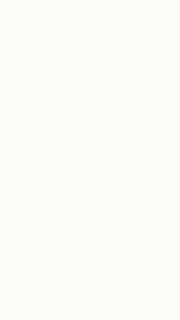 |  | 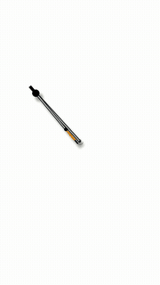 | 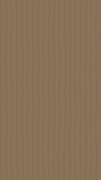 | 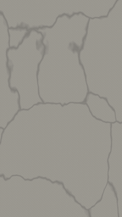 |

| **Relief: clay (moulded)**<br>`relief_clay` | **Van Gogh (moving)**<br>`anim_van_gogh` | **Oil paint (moving)**<br>`anim_oil_morph` | **Bizarre manga**<br>`bizarre_manga` | **Comic halftone**<br>`comic_halftone` |
|:---:|:---:|:---:|:---:|:---:|
| 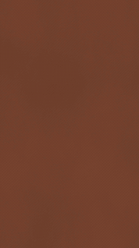 | 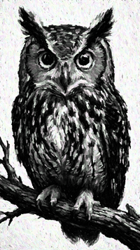 | 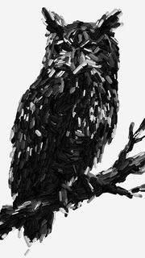 | 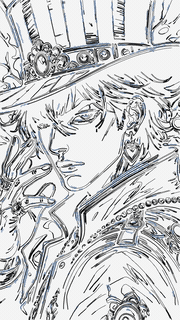 | 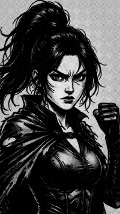 |

---

## How it works, in plain words

**1. It starts with a picture.** You give it a photo or picture, or describe an idea and a
local image model draws one first. That picture is the guide, like the photo an artist
pins next to the easel.

**2. The paint is simulated, not faked.** The paint engine
([claude-paint](https://github.com/aliceisjustplaying/claude-paint)) models real oil
paint: a brush is a set of bristles, paint is mixed on a palette from named tubes (lead
white, ochre, cobalt blue…), thick paint holds ridges, thin paint glazes, colours mix the
way pigments do, and paint dries over time.

**3. It paints the way a painter does: big to small.** It compares the canvas with the
picture, then blocks in the big shapes with a big brush, refines with smaller brushes, and
finishes with a fine one. Each time it looks at what it has painted so far and only adds
strokes where the canvas doesn't match yet. Every stroke follows the shape of the thing
it paints. A painting takes a few thousand strokes.

**4. Every stroke is recorded.** Where it went and when. That is how the video can follow
the brush (and, with `--hand`, show a hand moving exactly along each stroke).

**5. It's cut into a video.** A plain canvas, all of it in view the whole time: no zooming
in or out, you just watch the strokes go down until the picture is finished, then it
holds on it. The video keeps your picture's shape (landscape, portrait or
square). Music is up to you: calm public-domain classical, your own, or none.

### Other materials, same idea
- **Pencil** — simulated pencils of different softness; shading ruled line by line against a ruler, crossing like an engraving.
- **Pen** — every mark one pen line: a maze that forms the picture, op-art waves, one continuous line.
- **Compass spiral** — the picture drawn as one spiral of compass arcs; the line weight carries the picture.
- **Carving and clay** — a 3D block carved away (or clay built up) bit by bit, rendered in Blender under raking light, in wood, marble or terracotta.
- **Moving paintings** — a picture or a video clip repainted frame by frame, about 12 paintings a second, so the brushwork shimmers (the technique of the film *Loving Vincent*). Oil paint (moving) takes several pictures: they are its poses, in order, each smeared into the next in black oil paint and the last back into the first, so it loops. With one picture it sways gently; no image model is needed either way. The moving styles take the first picture's shape (so put the picture with the shape you want first), or a clip's own; a picture of another shape is fitted whole over a soft, blurred copy of itself, never cut off.
- **Bizarre manga** — made as manga is: a blue pencil rough, brush-pen ink (face first), hatching and solid blacks, the blue fades out, then flat bold colour under the ink. With `--hand`, a hand holds the pencil for the rough and the pen for the ink.
- **Comic halftone** — ink and printed dot shading over the whole panel; it fades in, holds, then softens from the edges (the dots stay crisp).

**The honest part:** there is no human painter and no real canvas. It is a computer
simulation of painting. What makes it more than a filter is that the paint, the brushes
and the order of the work are modelled on how real artists paint.

---

## The maths

**In the paint engine (claude-paint)**
- **Colour mixing — Kubelka–Munk theory.** Pigments absorb some light and scatter some back; the theory predicts what comes out when they are mixed or layered (why blue + yellow paint makes green, and why a thin glaze shows the colour beneath).
- **Bristles, wet paint and drying** — each bristle modelled, paint moving between brush and canvas, layers drying at rates set by pigment and thickness.

**In this project: deciding the strokes**
- **Colour difference the way eyes see it (CIELAB)** — so "how wrong is the canvas here?" matches what a person would notice.
- **Palette by clustering (k-means)** — thousands of stroke colours pooled into a few paint mixes, as a painter mixes a few piles.
- **Paint matching** — a few hundred test swatches painted by the engine and measured; each colour is matched to the nearest real mix.
- **Stroke direction — gradients and the structure tensor** — at each point, the direction brightness changes fastest is across an edge; strokes run at right angles to it, along the form.
- **Stroke placement — error-driven, coarse to fine** — strokes go where the canvas differs most from the picture; each layer uses a smaller brush.
- **Style fitting — SSIM** — a standard image-similarity measure, so tuning a style can't trade away the subject.

**The drawings**
- **Compass spiral** — half-circles alternating between two centres, each a little wider (the draftsman's method); pencil pressure along each arc follows the picture's darkness.
- **Maze — graph theory** — the picture cut into cells (small where dark, large where light); a random spanning tree (Prim's algorithm) joins every cell by exactly one path, which is what makes it a real, solvable maze.
- **Waves and continuous line** — sine waves that wobble faster where the picture is darker.
- **Ruled shading** — parallel lines at one angle per layer, cut where the picture lightens; layers cross as cross-hatching.
- **Risograph** — each colour split into ink layers by least squares, then halftone dots from cosine patterns.

**Carving and motion**
- **Depth** — a model estimates each point's distance from the camera; that becomes the carving's height.
- **Carving** — each cut lowers the surface under a rounded tool profile but never below the target; smoothing sets how much detail each tool can reach.
- **Motion** — parallax (near moves more than far), smooth random fields for swirling skies, optical flow between frames, and exponential easing so the camera glides.

---

## Install

**One line.** Open Terminal (macOS: press ⌘ Space, type *Terminal*) and paste:

```sh
curl -fsSL https://raw.githubusercontent.com/Dankwa-Wadie/NoobPainterSimulation/main/install.sh | bash
```

It does everything, so you don't need to clone the repo yourself:
- installs what's missing: git, Python 3, ffmpeg (via Homebrew on macOS, which it installs if needed) and Rust;
- downloads this project into `~/NoobPainterSimulation`;
- sets up a private Python environment and builds the paint engine (a few minutes the first time);
- offers the free classical music (about 500 MB; optional: videos can also be silent or use your own music);
- asks whether to install the optional local image model (about 20 GB);
- puts a **NoobPainterSimulation** launcher on your desktop;
- opens the app.

Run the same line again to update: it keeps what you've already downloaded (the music,
the image model) and doesn't ask for it again. Works on macOS (Apple Silicon or Intel) and Linux.

**On Windows**, open PowerShell (Start menu, type *PowerShell*) and paste:

```powershell
irm https://raw.githubusercontent.com/Dankwa-Wadie/NoobPainterSimulation/main/install.ps1 | iex
```

It installs what's missing with winget (Git, Python, ffmpeg, Rust and the C++ build tools
Rust needs; Windows may ask for permission), then does the same as above, into
`%USERPROFILE%\NoobPainterSimulation`. The one-click image-model install is for macOS and
Linux for now.

Afterwards, open the app any time by double-clicking **NoobPainterSimulation** on your
desktop (on Windows it is in the Start menu too). It opens in your browser; keep the
terminal window it opens running while you paint, and close it to quit. Double-clicking
again while it is open just brings the page back. From a terminal, the same thing is:

```sh
cd ~/NoobPainterSimulation && .venv/bin/python -m noobpainter ui
```

If the desktop launcher goes missing, `start.command` (macOS) and `start.cmd` (Windows)
in the project folder do the same, or run the installer again to put it back.

### The local image model (optional)

You only need this to paint from a **typed idea**; painting your own pictures works
without it. It is [Qwen-Image 2512](https://huggingface.co/unsloth/Qwen-Image-2512-GGUF)
running in [ComfyUI](https://github.com/comfyanonymous/ComfyUI) on your computer: free,
private, nothing sent anywhere.

- **Easiest:** in the app, press **Install it** under *Describe an idea*. Progress shows
  on the page, and you can press it again to resume if it stops.
- **Or in Terminal:** `bash ~/NoobPainterSimulation/tools/install_image_model.sh`

It downloads about 20 GB (it checks for 25 GB free first) into `~/ComfyUI-Installs/ComfyUI`
(set `NOOBPAINTER_COMFY_HOME` to put it elsewhere), and works best with 16 GB of memory
or more. About 3 minutes a picture on an Apple Silicon Mac. Files and sources:

| File | From | Size |
|---|---|---|
| `qwen-image-2512-Q4_K_M.gguf` | [unsloth/Qwen-Image-2512-GGUF](https://huggingface.co/unsloth/Qwen-Image-2512-GGUF) | 13.2 GB |
| `Qwen2.5-VL-7B-Instruct-Q4_K_M.gguf`, `mmproj-F16.gguf` | [unsloth/Qwen2.5-VL-7B-Instruct-GGUF](https://huggingface.co/unsloth/Qwen2.5-VL-7B-Instruct-GGUF) | 6.0 GB |
| `qwen_image_vae.safetensors` | [Comfy-Org/Qwen-Image_ComfyUI](https://huggingface.co/Comfy-Org/Qwen-Image_ComfyUI) | 0.25 GB |
| `Qwen-Image-2512-Lightning-8steps-V1.0-bf16.safetensors` | [lightx2v/Qwen-Image-2512-Lightning](https://huggingface.co/lightx2v/Qwen-Image-2512-Lightning) | 0.85 GB |

### Optional: Blender

The carving styles (`relief_wood`, `relief_marble`, `relief_clay`) render in
[Blender](https://www.blender.org/) (free). Everything for it is in the app, under **Extras**:

- **Install it:** press **Install Blender**. The app downloads the official build from
  blender.org (about 300 MB), checks it against blender.org's checksum, unpacks it into
  your own folders (no administrator needed) and connects it. Progress shows on the page.
- **Already have Blender?** The app looks in the usual places (Applications on macOS,
  Program Files on Windows, the system path on Linux). If it isn't found, press **Find it**
  after installing, or paste where it is and press **Connect**. The location is remembered
  in `settings.json`.

From the command line, `NOOBPAINTER_BLENDER` points at it too.

### By hand (if you prefer)

```sh
git clone https://github.com/Dankwa-Wadie/NoobPainterSimulation && cd NoobPainterSimulation
python3 -m venv .venv && .venv/bin/pip install -r requirements.txt
./setup.sh                                   # needs Rust: https://rustup.rs
.venv/bin/python tools/fetch_classical.py    # the music
```

## Use

**The app** — the easiest way:

```sh
cd ~/NoobPainterSimulation && .venv/bin/python -m noobpainter ui   # opens http://127.0.0.1:8770
```

Pick a style from the preview cards and drop in what it takes:
- **one picture** for most styles (a new one replaces the last);
- **several pictures, up to 8,** for Oil paint (moving): they become its poses, in order
  (reorder them with the arrows on their thumbnails);
- **a picture or a short video clip** for Van Gogh (moving) and Oil paint (moving), which
  repaint it frame by frame. The other styles don't take video.

Then choose what to make: **the painting video** (pick its length and whether to show a
hand) or **just the finished picture**, which is quicker and is a PNG to download. Every
style keeps your picture's shape: a landscape photo makes a landscape video (from a typed
idea, it's 9:16). The moving and ink styles are videos only.
A video can have no music, the free calm classical music (download it from the app if the
installer skipped it), or your own: choose a music file and it loops to the video's length.
Press **Paint it**: progress (with a **Cancel** button that stops it and its paint engine,
ffmpeg or Blender within seconds), a live view of the canvas and the finished video (with its
finished picture to download too) or picture appear on the page. Under a finished
video, **Add the hand** (or **Remove the hand**) cuts it again with the hand drawing or
painting every stroke, in about a minute, without painting it again (the app keeps the
last 3 paintings' frames for this; older ones are cleared to save space). Styles that are
only made as a video have "just the finished picture" greyed out. It runs on your
computer only.

**The command line:**

```sh
python -m noobpainter styles                                   # list the styles
python -m noobpainter paint photo.jpg --style van_gogh --out out/my-painting
python -m noobpainter paint photo.jpg --style pencil --hand    # with the hand overlay
python -m noobpainter paint photo.jpg --style van_gogh --picture-only   # just the picture, no video
python -m noobpainter paint portrait.png --style bizarre_manga
python -m noobpainter paint photo.jpg --style relief_wood      # carved (needs Blender)
python -m noobpainter paint --video clip.mp4 --style anim_van_gogh
python -m noobpainter paint pose1.jpg pose2.jpg pose3.jpg --style anim_oil_morph   # poses, looped
```

Each run writes `painting.mp4`, the finished `painting.png` and `credits.txt` (title,
description and the music's licence) into the output folder.

**Styles:** `contemporary`, `impressionist`, `van_gogh`, `old_master`, `baroque`, `pop`,
`caricature`, `bw_exaggerated`, `pencil`, `maze`, `waves`, `continuous`, `compass_spiral`,
`relief_wood`, `relief_marble`, `relief_clay`, `anim_van_gogh`, `anim_oil_morph`,
`bizarre_manga`, `comic_halftone`.

## Layout

| | |
|---|---|
| `noobpainter/brushwork.py` | plans the strokes: layers, colours, directions, style presets |
| `noobpainter/oilpaint.py` | paint mixing and swatch calibration |
| `noobpainter/handplay.py` | the video: the canvas as it's painted, compass/ruler, optional hand, music |
| `noobpainter/lineart.py` | maze, waves, continuous line, compass spiral |
| `noobpainter/carving.py`, `relief_scene.py` | carving and clay moulding, rendered in Blender |
| `noobpainter/paintanim.py` | moving paintings, and repainting a clip frame by frame |
| `noobpainter/stylefit.py` | fits a style to example pictures |
| `noobpainter/riso.py` | risograph print effect |
| `noobpainter/manga.py` | bizarre manga: rough, ink, hatching, blacks, then colour |
| `noobpainter/comicpanel.py` | comic halftone: screentone and blur |
| `noobpainter/pipeline.py` | picture/idea in, video out |
| `noobpainter/ui.py` | the web app |
| `noobpainter/wanvideo.py` | **experimental:** local video model (Wan 2.2) for motion — unreliable on a 24 GB Mac; only subtle motion |
| `tools/fetch_classical.py` | downloads calm classical recordings, checks licences and voices |

## Credits and licences

This project is MIT-licensed (see `LICENSE`).

- **Paint engine:** [claude-paint](https://github.com/aliceisjustplaying/claude-paint) by aliceisjustplaying (MIT), fetched by `setup.sh`; this project adds one small read-only clock (`patches/`).
- **Music:** recordings from [Musopen](https://musopen.org) via Wikimedia Commons, public domain or CC0; each video's `credits.txt` names its track.
- **Font:** Montserrat (SIL Open Font License, `assets/fonts/OFL-montserrat.txt`).
- **Hand images** (`assets/hand`) were generated locally with Qwen-Image.
- Every video says it is made by a simulation, not a human artist.
